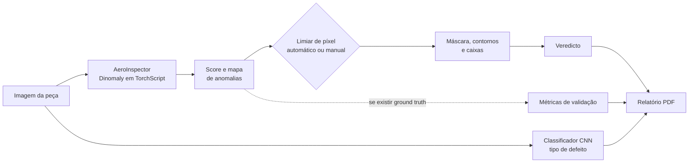

# VISORA

**Inspeção inteligente de peças, focada no setor aeroespacial.**

Aplicação web que apoia a inspeção visual de pás de motor aeronáutico com deteção de anomalias não supervisionada: o utilizador carrega uma imagem e o sistema devolve o veredicto, o mapa de anomalias, a localização do defeito, o tipo de defeito, as métricas de validação e um relatório em PDF.

Projeto desenvolvido pela equipa **VISORA** no **Hack4Guimarães 2035** (19/10/2026 a 23/10/2026).


---

## Porquê a VISORA

A inspeção manual é lenta, depende do inspetor e raramente deixa um registo quantificado. A VISORA procura **aumentar a velocidade das inspeções sem comprometer a fiabilidade dos resultados**, funcionando como ferramenta de apoio ao inspetor (triagem, localização e registo), e não como substituto de um inspetor certificado.

## Funcionalidades

- **Veredicto** da peça: conforme ou defeituosa.
- **Diagnóstico visual** em várias vistas: imagem original, mapa de anomalias (heatmap), sobreposição e delimitação do defeito com caixas.
- **Limiar de deteção** automático ou manual, ajustável na barra lateral.
- **Classificação do tipo de defeito** (`ablation`, `breakdown`, `fracture`, `groove`) por uma CNN com transfer learning, com recurso a uma heurística morfológica caso o classificador não esteja disponível.
- **Métricas de validação** quando existe máscara de referência (ground truth): Pixel AUROC, Localization Precision @ FPR 5%, PRO score, F1 (Dice), IoU, Precision e Recall, mais um mapa comparativo com verdadeiros positivos, falsos negativos e falsos positivos.
- **Relatório de inspeção em PDF**, com veredicto, limiar, considerações operacionais sobre o defeito e tabela de métricas interpretadas.
- **Dois modos de entrada:** ficheiros (uma imagem ou várias, com navegação entre elas) e câmara.
- **Execução em GPU (CUDA)** com recurso automático a CPU.

## Como funciona



1. O **`AeroInspector`** (`engine.py`) carrega o modelo Dinomaly exportado em TorchScript e, para cada imagem, obtém o score global e o mapa de anomalias por píxel.
2. O mapa é normalizado e redimensionado para a imagem original. Um **limiar de píxel** converte-o numa máscara; as regiões ligadas acima de uma área mínima (10 px) são tratadas como defeitos e delimitadas por caixas. O veredicto depende da existência dessas regiões.
3. O **limiar automático** usa o método de Otsu sobre o mapa. Quando existe uma máscara de referência para a imagem, usa o limiar que maximiza o F1 em relação a essa máscara.
4. Se for detetada uma anomalia, o **classificador CNN** indica o tipo de defeito. Sem o classificador, `report.py` recorre a uma heurística baseada na forma da região.
5. O `report.py` gera o **relatório em PDF** (ReportLab, com um gerador de PDF próprio como alternativa caso a biblioteca falhe).

## Estrutura do repositório

```
.
├── app_v6.py        # Interface web em Streamlit
├── engine.py        # AeroInspector: inferência, limiares, máscaras, contornos
├── metrics.py       # Métricas de deteção e localização, limiares ótimos, mapa comparativo
├── report.py        # Tipo de defeito, interpretação das métricas e relatório em PDF
└── models/          # Pesos do modelo (não incluídos, ver abaixo)
    ├── Dinomaly_traced.pt
    └── cnn_tl_traced.pt
```

## Instalação

Requisitos: **Python 3.11**. Recomenda-se um ambiente Conda, para evitar conflitos de dependências (testado em Windows com GPU NVIDIA, com execução em CPU como alternativa).

```bash
conda create -n visora python=3.11
conda activate visora

# PyTorch e torchvision: escolher o comando adequado em https://pytorch.org/get-started/locally/
pip install torch torchvision

pip install streamlit opencv-python numpy pillow scikit-learn reportlab
```

## Modelos e dados

**Pesos do modelo.** A aplicação procura os ficheiros em `models/`:

| Ficheiro | Função |
|---|---|
| `models/Dinomaly_traced.pt` | Deteção de anomalias (Dinomaly exportado em TorchScript, treinado só com imagens sem defeito do AeBAD) |
| `models/cnn_tl_traced.pt` | Classificação do tipo de defeito (CNN com transfer learning, quatro classes) |

> Os pesos não estão incluídos neste repositório. **[Indicar aqui onde os obter, por exemplo uma ligação de descarga.]**
> Sem `Dinomaly_traced.pt` a aplicação não faz inspeção. Sem `cnn_tl_traced.pt` usa a heurística morfológica para o tipo de defeito.

**Dados.** Foi usado o conjunto de dados **AeBAD** (Aero-engine Blade Anomaly Detection), disponibilizado no repositório [zhangzilongc/MMR](https://github.com/zhangzilongc/MMR) sob licença [CC BY 4.0](https://creativecommons.org/licenses/by/4.0/). Para ver as métricas de validação, coloca as máscaras de referência numa pasta `ground_truth/` (ou na estrutura do `AeBAD_S/`) ao lado da aplicação: a aplicação associa cada imagem à máscara pelo nome do ficheiro.

## Utilização

```bash
streamlit run app_v6.py
```

Abre o endereço indicado no terminal (por defeito, `http://localhost:8501`).

1. Escolhe o modo **Ficheiro** ou **Câmara**.
2. Carrega uma imagem (`.png` ou `.jpg`), várias imagens de uma vez, ou tira uma fotografia. A inspeção corre logo a seguir.
3. Analisa o veredicto e o diagnóstico visual.
4. No modo Ficheiro, clica em **Calcular Métricas** para comparar com a máscara de referência, se existir. Na barra lateral podes ajustar o **limiar de deteção**: automático (por defeito) ou manual.
5. Em **Relatório de Inspeção**, vê o tipo de anomalia e descarrega o **PDF**.

No modo Câmara não existe máscara de referência, por isso só estão disponíveis o diagnóstico visual, o veredicto e o relatório.

## Tipos de defeito

| Classe | Descrição resumida |
|---|---|
| `ablation` | Degradação do material por exposição contínua a gases a alta temperatura |
| `breakdown` | Quebra da pá, por exemplo por impacto de corpos estranhos |
| `groove` | Pequenas ranhuras na margem, associadas a ciclos de tensão, que podem evoluir para fratura |
| `fracture` | Áreas em falta na pá, resultantes da evolução de ablação ou de ranhuras |

## Limitações

- **Ferramenta de apoio.** A VISORA não substitui um inspetor certificado nem um processo de validação formal para uso em serviço.
- **Âmbito dos dados.** O modelo foi treinado com imagens de pás do AeBAD. O desempenho noutros tipos de peça, câmaras ou condições de iluminação não foi avaliado.
- **Limiar e veredicto.** O mapa de anomalias é normalizado por imagem e o veredicto depende do limiar de píxel escolhido, pelo que a calibração do limiar influencia diretamente os falsos positivos e os falsos negativos.
- **Métricas otimistas na demonstração.** No modo automático, quando existe máscara de referência, o limiar é calibrado com essa mesma máscara. As métricas assim obtidas servem para demonstrar o sistema e não são uma avaliação independente do desempenho.
- **Tipo de defeito.** Quando o classificador CNN não está disponível, o tipo de defeito é estimado por uma heurística simples sobre a forma da região, menos fiável.

## Equipa

- Beatriz Duarte
- Carolina Freitas
- Francisco Moreira
- João Borges
- Sofia Martins

**Mentores:** Leandro Leite, Miguel Amador e Yusbel Castilla.

A documentação completa dos recursos usados e da distinção entre o trabalho da equipa e os recursos de terceiros está na Declaração de Originalidade entregue no hackathon.
